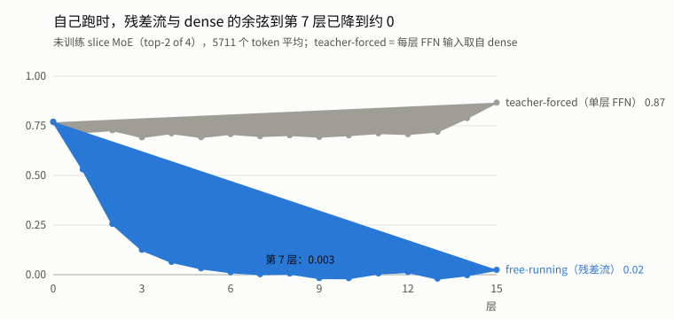
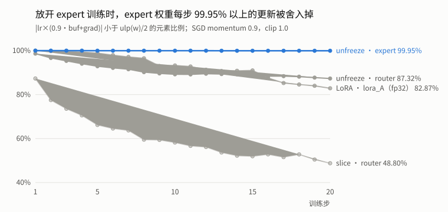

# Llama 3.2-1B 推理效率实验记录

2026-10-15 · 逐条的原始记录见 [`EXPERIMENTS.md`](../EXPERIMENTS.md)，数据见 [`results/`](../results/)。图由 [`scripts/plot_report.py`](../scripts/plot_report.py) 从 csv 生成。

## 概述

在 A100 上重新测量了 Llama 3.2-1B 的 INT4 weight-only 量化和两种 MoE 改造（slice / LoRA），并补做了 5 项验证实验。本文只记录做了什么和测到了什么；每个实验的"预测"和"解释"待补。

### 环境

| 项 | 值 |
|---|---|
| GPU | NVIDIA A100-PCIE-40GB（HBM2 约 1555 GB/s，FP16 tensor core 约 312 TFLOPS） |
| 软件 | PyTorch 2.8.0+cu128，Driver 595.71.05，Nsight Systems 2025.6.3 |
| 模型 | Llama 3.2-1B，Meta 原始权重 `consolidated.00.pth` |
| 数据 | Alpaca 前 500 条（0–199 训练，200–299 评估，共 5711 个评估 token）；10 条 MT-bench 风格 prompt；WikiText-2 test（289,082 token） |

### 测量方法

- **性能**（`bench.py`）：随机 token 输入，GPU 上 greedy argmax，输出长度固定；warmup 3 轮、计时 10 轮；CUDA event 记录 prefill 和每步 decode；prefill / e2e 取中位数，decode 取所有步的中位数。warmup 第 1 轮单独记为 cold。
- **显存**：warmup 后重置峰值，取计时阶段的 `max_memory_allocated`；static = 模型建好（含预分配 KV cache）后的常驻显存。
- **质量**：PPL = exp(平均交叉熵)；acc = top-1 预测命中下一个 token 的比例。
- **profiling**：nsys 只抓 warmup 之后带 NVTX 的一轮；另有一份抓整个进程的报告，用于冷启动分析。

### 脚本一览

| 脚本 | 用途 | 对应实验 |
|---|---|---|
| `run_benchmark.py` | 原始端到端 benchmark（未修改） | E0 |
| `bench.py` | prefill / decode / 显存，支持 nsys | E2、E4、E5、E6、E10 |
| `mem_snapshot.py` | 峰值时刻存活的显存块及分配位置 | E3 |
| `eval_ppl.py` | FP16 vs INT4 的 PPL / acc / agree / KL | E1、E1b |
| `slice_scale.py` | 未训练 slice MoE 每层输出与 dense FFN 的量级对比 | E7b |
| `update_rounding.py` | 每步 SGD 更新被舍入掉的比例 | E8c |
| `train_moe.py` / `eval_moe.py` | MoE 训练与评估（`--seed`、`--ckpt`） | E7、E8、E9a |
| `scripts/run_*.sh` | 实验驱动脚本 | – |

## E0 原始 benchmark 复现

原始 `run_benchmark.py` 在 A100 上可以复现：峰值显存与旧报告（P100）逐 MB 一致，两次独立运行的时间相差 ≤ 3%。计时是单次 `generate()` 端到端（prefill + 32 步 decode + 采样），没有 warmup。

| input 256 / output 32 | bs=1 | bs=8 | bs=16 |
|---|---:|---:|---:|
| FP16 时间 (s) | 1.10 | 0.68 | 0.72 |
| FP16 峰值显存 (MB) | 3072 | 4495 | 6134 |
| INT4 时间 (s) | 1.55 | 1.67 | 1.78 |
| INT4 峰值显存 (MB) | 4540 | 5508 | 6621 |

| bs=1 | Dense | MoE-slice | MoE-LoRA |
|---|---:|---:|---:|
| 时间 (s) | 0.56 | 2.71 | 2.83 |
| 峰值显存 (MB) | 3074 | 3075 | 3082 |

- **FP16 bs=1（1.10 s）比 bs=8（0.68 s）还慢**，而同配置的 Dense 行只要 0.56 s。唯一的区别是 FP16 bs=1 是进程内第一次 `generate()` → 见 P1。
- INT4 比 FP16 慢 2.5–2.8×，且峰值显存更高；MoE 比 Dense 慢约 5×。
- bs=1 FP16 约 17 ms/step，而只读一遍权重的带宽下限是 2.5 GB / 1555 GB/s ≈ 1.6 ms。
- 2026-10-14 重跑一次：FP16 1.11 / 0.70 / 0.73 s，INT4 1.56 / 1.66 / 1.73 s，Dense 0.57 s，MoE 2.79 / 2.81 s，峰值显存逐 MB 相同。

## Part 1：INT4 量化

INT4（g128）把模型从 2858 MB 压到 1127 MB（−60.6%），但 WikiText-2 PPL 从 9.89 升到 12.29，decode 每步从 15.0 ms 变成 40.5 ms，bs=1 峰值显存反而比 FP16 高 1.5 GB。量化方式：每组 min/max 非对称 RTN，scale / zero_point 存 FP16，每次 forward 先整层 dequant 再做 FP16 矩阵乘。

### E1 模型大小

| | 实测 (MB) |
|---|---:|
| FP16 | 2858.1 |
| INT4 g128 | 1127.2（parameters 501.1 + buffers 626.1） |
| INT4 g64 / g32 | 1164.0 / 1237.7 |
| 减少比例（g128） | 60.6% |

params + buffers，不含 KV cache。INT4 的 parameters 部分是未量化的 embedding 和 norm。

### E1b INT4 质量

`eval_ppl.py`：所有模型在同一批片段上逐段对比。agree = INT4 与 FP16 的 top-1 相同的比例；KL = 每 token 平均 KL(P_fp16 ‖ P_int4)，单位 nats。

- **Alpaca[200:300]**：与 `eval_moe.py` 同口径（每条单独，截断 128 token）。FP16 得到 9.6602 / 51.37%，复现了 MoE 实验里的 Dense 基准。
- **WikiText-2 test**：GPTQ / AWQ 口径，全文拼接后切成不重叠的 ctx 窗口，每窗预测 ctx−1 个 token。
- 模型代码没有 Llama 3.1+ 的 RoPE scaling（P3），绝对 PPL 可能与 HF 参考值略有不同；FP16 与 INT4 的差值不受影响。

| | Alpaca PPL / acc | WikiText ctx=2048 PPL / acc | agree / KL（ctx=2048） | WikiText ctx=1024 PPL / acc |
|---|---|---|---|---|
| FP16 | 9.66 / 51.37% | 9.89 / 51.71% | – | 11.08 / 50.36% |
| INT4 g32 | 10.30 / 50.27% | 11.03 / 50.09% | 83.06% / 0.110 | 12.38 / 48.72% |
| INT4 g64 | 10.55 / 49.92% | 11.52 / 49.45% | 80.56% / 0.154 | 12.90 / 48.12% |
| INT4 g128（默认） | 11.03 / 49.87% | 12.29 / 48.51% | 77.27% / 0.217 | 13.71 / 47.19% |

- g128 在 WikiText ctx=2048 上 PPL **+2.40（+24%）**，acc −3.2 pp；g64 / g32 的 ΔPPL 是 +1.63 / +1.14。
- 即使 g32，也有约 17% 的位置 top-1 与 FP16 不同。
- ctx 1024 与 2048 下 INT4 的 ΔPPL 相近（g128：+2.63 vs +2.40），KL 几乎不变。

### E2 FP16 vs INT4 性能

`bench.py`，input 256 / output 32。

| | bs=1 | bs=8 | bs=16 |
|---|---:|---:|---:|
| FP16 prefill (ms) | 17.71 | 40.91 | 87.06 |
| FP16 decode (ms/step) | 14.96 | 16.33 | 15.94 |
| FP16 static / peak (MB) | 2869 / 3067 | 2941 / 4454 | 3027 / 6050 |
| INT4 prefill (ms) | 46.18 | 78.78 | 124.31 |
| INT4 decode (ms/step) | 40.46 | 43.53 | 45.59 |
| INT4 static / peak (MB) | 1137 / 4536 | 1210 / 5476 | 1290 / 6558 |

- decode 几乎不随 bs 变；bs=1 的 prefill（256 token）≈ 1 步 decode。
- INT4 每次 forward 多出一个近似固定的开销：decode +25.5 ms，prefill +28 ms，与 token 数基本无关。
- FP16 bs=16 prefill ≈ 141 TFLOPS，接近单独 GEMM 测到的约 149 TFLOPS。
- FP16 每多一条序列，peak − static 涨约 190 MB。

### E3 INT4 峰值显存来源

`mem_snapshot.py` 回放 PyTorch memory snapshot，找峰值时刻仍存活的块。

| 配置 | static (MB) | peak (MB) | 峰值时多出的块 |
|---|---:|---:|---|
| INT4 bs=1 | 1145 | 4535 | 3 × 1002 MB fp32（`quantize.py:101–102` 的 `.float()`、减 zero_point、乘 scale）+ 2 × 125 MB uint8（`w_even` / `w_odd`）+ 125 MB 上一步 logits |
| FP16 bs=1 | 2877 | 3066 | 125 MB fp32 logits + 63 MB fp16 logits（`model.py:455`） |
| FP16 bs=16 | 2998 | 6021 | 同上 ×16 |

- 1002 MB = 128256 × 2048 × 4 B，正好是 lm_head 的 fp32 全尺寸张量 → INT4 峰值来自**形状最大的那一层（lm_head）的 dequant 临时张量**，而不是旧报告所说的"整个模型物化了一份 FP16"。
- FP16 的 peak − static 全部是 prefill 对 256 个位置都算了 logits，而生成只用最后一个位置。

### E4 INT4 时间花在哪

nsys（bs=1，1 次 prefill + 31 步 decode）：GPU kernel 总时间约 1.27 s，FP16 同配置约 0.20 s。

- dequant 相关的逐元素 kernel（减 zero_point / 乘 scale、交错写回、`.half()`、位运算等）合计约 **90.8%**，GEMM / GEMV 只占约 6.2%。
- 量化的 Linear 共 113 个（16 层 × 7 + lm_head），多个 kernel 的次数 / forward 正好是 113 的倍数 → 每个 Linear 每次 forward 都完整 dequant 一遍。
- GPU 忙碌约 39.6 ms / forward，与 decode 实测 40.5 ms 几乎相等；计时末尾的 `cudaDeviceSynchronize` INT4 等 7.6 ms，FP16 只等 0.31 ms → INT4 是 GPU-bound。

### E5 FP16 decode 离带宽上限多远

nsys（FP16 bs=1）：每次 forward 约 680 次 kernel launch，GPU 每步只忙约 6 ms，而 decode 每步 15 ms → **launch-bound**，GPU 大部分时间在等 CPU 发 kernel。单个大 kernel（decode 的 lm_head GEMM，406 µs）已达到约 83% 带宽；GPU 侧 6 ms 仍高于 1.6 ms 下限，其中 copy / cast 小 kernel 占 13.6%。

## Part 2：MoE

N=4 个 expert、每 token 选 top-2。slice 把 dense FFN 的隐藏单元切成 4 份当 expert；LoRA 保留冻结的 dense FFN，再加 4 个 rank 8 的 LoRA expert（B 初始化为 0）。结果：slice 一转换就坏（PPL 32 万），训练后仍是 dense 的数百倍；LoRA 训练 6 epoch 后 acc 比 dense 高 0.74–0.95 pp；两者推理都因为逐 token 循环而很慢。

### E6 参数、显存与速度

| | Dense | MoE-slice | MoE-LoRA |
|---|---:|---:|---:|
| 总参数 | 1,498,482,688 | 1,498,613,760 | 1,500,710,912 |
| 可训练参数 | 0 | 131,072 | 2,228,224 |
| 峰值显存 (MB) | 3074 | 3075 | 3082 |
| prefill 256 token (ms) | 17.71 | 1695.58 | 1695.96 |
| decode (ms/step) | 14.96 | 24.24 | 27.05 |
| 短 prompt 生成速度 (tok/s) | 53.5–55.1 | 23.7–31.8 | 28.7–28.9 |

MoE 的 prefill 慢约 96×，decode 只慢 1.6–1.8×。

### E7 转换后、训练前的质量

| | Dense | slice（未训练） | LoRA（未训练） |
|---|---:|---:|---:|
| PPL | 9.66 | **326,843.71** | 9.66 |
| acc | 51.37% | **0.00%** | 51.37% |

LoRA 未训练时与 Dense 逐位一致；slice 的 PPL 比均匀随机猜（= 词表大小 128,256）还差。

### E7b slice 输出量级（未训练）

`slice_scale.py`，同样的 5711 个 token。**teacher-forced**：每层 FFN 的输入都取自 dense 模型，比较 MoE FFN 输出与 dense FFN 输出；**free-running**：MoE 模型自己跑，比较每层之后的残差流。

| teacher-forced（16 层范围） | 范数比 ‖v‖/‖dense‖ | 余弦 |
|---|---:|---:|
| 4 个 expert 全加、权重 1 | 1.0000 | 1.0000 |
| top-2、权重 1 | 0.58–0.72 | 0.69–0.87 |
| top-2 × router 权重（实际输出） | **0.29–0.36** | 0.69–0.87 |
| 单个 expert | 0.35–0.51 | – |

- 4 个 expert 全加精确等于 dense（最大绝对误差 ≤ 0.36，在 layer 1）→ 切分本身无损。
- top-1 归一化权重 0.52–0.54：两个被选 expert 的权重接近 0.5 / 0.5。
- free-running 的范数比在 layer 7 达到 2.2，到 layer 15 回到 1.05。

### E8 训练与训练后评估

200 条训练样本，SGD momentum 0.9，lr_router 1e-3 / lr_expert 1e-4，seed 42，max_seq_len 64。评估都在同一 held-out 5711 token 上。

| run | 可训练参数 | loss（首 → 末 epoch） | PPL | acc |
|---|---:|---|---:|---:|
| slice（2 ep） | 131,072 | 10.46 → 8.24 | 3430.71 | 4.08% |
| slice（6 ep） | 131,072 | 10.46 → 7.49 | 2174.31 | 4.80% |
| slice + 放开 expert（2 ep，FP16） | 805,437,440 | 9.23 → **9.35** | 6713.77 | 2.85% |
| LoRA（2 ep） | 2,228,224 | 2.3773 → 2.3723 | 9.59 | 51.53% |
| LoRA lr_expert ×10（2 ep） | 2,228,224 | 2.3542 → 2.2942 | **10.56** | 51.53% |
| LoRA（6 ep） | 2,228,224 | 2.3773 → 2.3439 | 9.36 | 52.20% |

- slice 放开 expert 后 epoch 2 的 loss **上升**，PPL 比只训 router 还差，没有 NaN。
- LoRA lr ×10：训练 loss 降得更多，held-out PPL 反而从 9.66 升到 10.56。
- LoRA 的 loss / PPL / acc 与旧报告（A40）完全一致；slice 不一致（旧 PPL 3414.03）。同机同 seed 的两次 slice run 前两个 epoch 逐位一致。

### E8c 优化器更新被舍入掉了多少

`update_rounding.py` 按 `train_moe.py` 的设置跑前 20 步（含全局 `clip_grad_norm_(1.0)`）。每步算预期更新 Δ = lr × (0.9·buf + grad)，统计 |Δ| < ulp(w)/2（会被舍入回原值）的比例，并在 `step()` 后逐位比较权重核对。两种统计每一行都一致（差 ≤ 0.01 pp）。

| 配置 / 参数组 | clip 前 grad norm（20 步范围） | grad 恰为 0 | Δ/ulp 中位数（第 1 → 20 步） |
|---|---:|---:|---|
| slice / router（fp16） | 3.2–27.1 | 19–34% | 0.037 → 0.53 |
| slice-unfreeze / router（fp16） | 46–121 | 24–34% | 0.0036 → 0.044 |
| slice-unfreeze / expert（fp16，805 M） | 46–121 | 25–35% | 1.7e-5 → 1.2e-4 |
| LoRA / router（fp32） | 1.9–7.9 | 第 1 步 100%，第 20 步 0% | 0 → 0.24 |
| LoRA / lora_A（fp32） | 1.9–7.9 | 第 1 步 100%，之后 0% | 0 → 0.089 |
| LoRA / lora_B（fp32，初值 0） | 1.9–7.9 | 0–1.6% | ≥ 9e5（Δ≠0 的更新从不丢失） |

- slice 放开 expert 时，**expert 权重每步 ≥ 99.95% 的更新被舍入掉**；同一个 router 在放开 expert 时丢失 87–99%，只训 router 时丢失 49–87%。
- LoRA 第 1 步 router 和 lora_A 的梯度全为 0（此时 lora_B = 0）；lora_A 虽是 fp32，前 20 步仍有 83–99.8% 的更新被舍入掉。
- router 初始化与 E8 的 run 不同（`train_moe.py` 在转换前消耗了随机数）。

### E9a LoRA 训练 seed 方差（6 epoch）

| seed | loss（epoch 1 → 6） | PPL | acc | acc − Dense |
|---:|---|---:|---:|---:|
| 1 | 2.3771 → 2.3419 | 9.36 | 52.32% | +0.95 pp |
| 2 | 2.3772 → 2.3444 | 9.37 | 52.23% | +0.86 pp |
| 3 | 2.3774 → 2.3488 | 9.41 | 52.11% | +0.74 pp |
| 42 | 2.3773 → 2.3439 | 9.36 | 52.20% | +0.83 pp |
| 均值 ± 标准差 | | 9.375 ± 0.024 | 52.22% ± 0.09 pp | +0.85 pp |

- 4 个 seed 在同一张 GPU 上并行跑。并行的 seed 42 与之前串行的 LoRA 6 ep，6 个 epoch 的 loss 全精度逐位相同 → 并行不改变数值，只影响耗时（每 epoch 342–388 s vs 233–239 s）。
- 只量了训练 seed 的方差；评估集本身的抽样不确定性没有量。

### E10 MoE 慢在哪

nsys（MoE-LoRA bs=1，1 次 prefill + 31 步 decode）：

| CUDA API | 次数 | 总时间 | FP16 对照次数 |
|---|---:|---:|---:|
| `cudaLaunchKernel` | 109,890 | 761 ms | 21,602 |
| `cudaMemcpyAsync` | 19,392 | 198 ms | 1,024 |
| `cudaStreamSynchronize` | **9,184** | 105 ms | 0 |

9,184 = 256 token × top-2 × 16 层 + 31 × 1 × 2 × 16，精确吻合逐 token 循环里的 `.item()`；19,392 = 2 × 9,184 + 1,024。

### E11 Expert 负载

训练后，10 条 prompt，前 4 层。top-2 of 4 下单个 expert 占比上限 50%。

| Layer | slice E0 / E1 / E2 / E3 | LoRA E0 / E1 / E2 / E3 |
|---:|---|---|
| 0 | 14 / 15 / 22 / 49% | 25 / 21 / 34 / 21% |
| 1 | 50 / 34 / 7 / 9% | 30 / 11 / 21 / 38% |
| 2 | 24 / 50 / 13 / 14% | 17 / 33 / 20 / 30% |
| 3 | 22 / 50 / 14 / 14% | 31 / 28 / 31 / 10% |

slice 的 layer 1–3 都有 expert 到了 50%，即每个 token 都选了它；LoRA 更分散但也不均匀。

## 问题记录

### P1 FP16 bs=1 比 bs=8 还慢（冷启动）

进程内第一次生成比稳态多约 500 ms，全部出在首次 prefill 和第 1 步 decode，GPU 上的工作完全相同。分析用的是抓整个进程的 nsys 报告（5 轮），按每轮 33 个 `cudaEventRecord` 切分后逐轮比较。

| | rep 0（cold） | rep 1 |
|---|---:|---:|
| 整轮 CPU 时间 (ms) | 1312.8 | 800.0 |
| prefill (ms) | **429.0** | 26.7 |
| decode 第 1 步 (ms) | **141.9** | 24.4 |
| decode 第 2 步 (ms) | 26.5 | 24.7 |
| kernel 数 / GPU kernel 时间 | 21,906 / 203.5 ms | 21,906 / 203.5 ms |
| CUDA API 时间 / API 之外的 CPU 时间 (ms) | 443.3 / 869.5 | 179.6 / 620.4 |

多出的 513 ms 由以下部分组成（nsys 下各轮都变慢，但首轮多出的量与不开 nsys 时的 cold − e2e ≈ 500 ms 一致）：

- **首次 launch +195 ms**：只有 10 次 launch 比 rep 1 同位置慢 0.2 ms 以上。最慢的是 decode 第 1 步的 `indexSelectSmallIndex`（单 token 的 embedding 查表，prefill 不用这个 kernel）75.6 ms；prefill 里有 `vectorized_elementwise_kernel` ×3（合计 51.5 ms）、`softmax_warp_forward` 24.4 ms、`splitKreduce_kernel` 16.8 ms 等。
- **`cuLibraryLoadData` ×14，+48.7 ms**：都在首次 prefill 的第一个 GEMM 前后，rep 1 起不再出现。
- **CUDA API 之外的 CPU 时间 +249 ms**：最大的一段空隙 115.6 ms，在最后一次 `cuInit` 之后、第一次 `cuLibraryLoadData` 之前。采集时没开 CPU 采样，这段时间 CPU 在做什么还未定性。
- 其余：`cuKernelGetFunction` +8.6 ms，`cudaMalloc` / `cudaFree` 13 次 +6.5 ms。

### P2 数据下载失败（环境）

`load_dataset("tatsu-lab/alpaca")` 报 `TypeError: process() takes no keyword arguments`。traceback 最底层是 httpx 解压响应，镜像自带的 Brotli 1.0.9 不支持新参数；`pip install -U brotli`（→ 1.2.0）解决。

### P3 RoPE 缩放缺失

`ckpt/params.json` 中 `use_scaled_rope: true`，但 `llama/model.py` 没有实现 Llama 3.1+ 的 `apply_scaling`。短序列下输出仍通顺，但 dense baseline 与官方模型不完全一致；影响待改进阶段实现后对比 PPL。

### 实验过程中的操作事故

| 日期 | 事件 | 后果 / 处理 |
|---|---|---|
| 2026-10-14 | 服务器上误重跑 `scripts/run_orig.sh`，同名日志被覆盖 | 10-13 的 `benchmark_orig.log`、`train_slice.log` 原版丢失；重跑版与原版数字相差 ≤ 3%；之后新实验一律用新日志名 |
| 2026-10-14 | 服务器有本地提交，`git pull` 拒绝；`git reset --hard` 后 `logs/` 被删（那个提交曾跟踪 `logs/`） | 用 `git archive <commit> logs \| tar x` 恢复；恢复出的两份旧日志与重跑版逐字节相同，原版无法找回 |
| 2026-10-14 | `update_rounding.py` 第一版把 LoRA 的 A 和 B 混在一组统计 | 结果无法解读；拆成 lora_A / lora_B 重跑，旧行在 csv 里标为 `group=lora`，忽略 |

## 未完成项与后续

测量阶段的 5 项待做实验已全部完成；剩下的是补写分析、两个可选实验，以及改进阶段。

- [ ] 在 `EXPERIMENTS.md` 各节补写"预测"和"解释"
- [ ] 可选：在同一批 5711 个 token 上做逐 token 配对检验（McNemar 或按样本 bootstrap），判断 LoRA 的 +0.83 pp 是否超过评估集噪声
- [ ] 可选：用 `nsys --sample=cpu` 重采 FP16 整进程报告，定性 P1 里 115.6 ms 的 CPU 空隙
- [ ] 改进阶段：CUDA Graph / `torch.compile`（FP16 decode）、fused dequant kernel（INT4 速度与峰值显存）、向量化 MoE forward（去掉逐 token `.item()`）、实现 RoPE scaling（P3）
